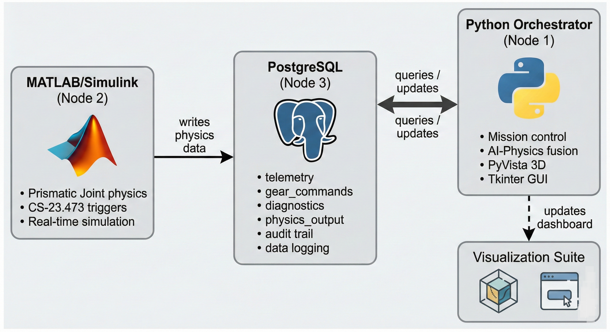

# PHI-Twin: Certification-Aware Digital Twin for Dornier 228 Landing Gear Health Monitoring

Official open-source implementation accompanying the **AIAA *Journal of Aerospace Information Systems*** publication:

> **Certification-Aware Digital Twin for Landing Gear Health Monitoring via AI–Physics Fusion**  
> Mohammed Bello Sani, Loveth Ote Uhiah, Samuel David Iyaghigba, Rexcharles Enyinna Donatus, and Joel Adewale Ajayi  
> Air Force Institute of Technology (AFIT), Kaduna, Nigeria  
> **DOI:** [10.2514/1.I011895](https://arc.aiaa.org/doi/10.2514/1.I011895)

---

## Overview

**PHI-Twin** (*Physics Hybrid Integrity–Twin*, workspace code **AeroTwin**) is a four-node cyber-physical landing gear Prognostics and Health Management (PHM) pipeline for the **Dornier 228-212** commuter turboprop:

1. **FlightGear Cross-Simulator Telemetry** — Streams 16-field Dornier 228 landing-gear state telemetry over UDP (`:15000`) via [`flightgear/aerotwin_proto.xml`](flightgear/aerotwin_proto.xml) into [`fg_connect.py`](fg_connect.py) (or the unified [`fleet_dashboard.py`](fleet_dashboard.py)).
2. **MATLAB Simscape Multibody Physics Plant** — [`Fancy_Landing_Gear.slx`](Fancy_Landing_Gear.slx) driven by [`launch_twin.m`](launch_twin.m) (live synchronization) and [`Master_Dataset_Gen.m`](Master_Dataset_Gen.m) (9,500-cycle synthetic dataset factory with `tireFriction`, `polytropicKRatio`, `orificeB`, and `sealFriction`).
3. **PostgreSQL Digital Flight Recorder** — [`aerotwin_schema.sql`](aerotwin_schema.sql) persists high-rate telemetry, gear commands, touchdown markers, Simscape Prismatic Joint waveforms (`ready_for_ai` / `ai_consumed` handshake), and audit-logged fault diagnostics.
4. **Dual-Input Conv1D–LSTM + Confidence-Weighted Fusion ($\tau = 0.65$) & Visualization** — [`AeroTwin_V16_Model.h5`](AeroTwin_V16_Model.h5) (111,019 parameters) classifies 11 ATA-32 landing-gear fault modes, falls back to the deterministic plant-reference class below $\tau = 0.65$, enforces independent **CS-23.473** deterministic load-exceedance checks ($\text{sink rate} \ge 3.05\text{ m/s}$ or $\text{vertical acceleration} \ge 1.80\text{ g}$), and renders live telemetry + 3D strut state in [`phi_fleet_server.py`](phi_fleet_server.py) / [`fleet_dashboard.py`](fleet_dashboard.py) and PyVista.



---

## Repository Structure

```text
.
├── aerotwin_config.py                   # Shared path & .env-backed PostgreSQL/UDP config
├── aerotwin_runtime.py                  # Shared physics fallback, AI-fusion, DB snapshot & PyVista helpers
├── aerotwin_schema.sql                  # Primary 6-table PostgreSQL schema
├── migrate_schema.py                    # Safe schema migration helper
├── fg_connect.py                        # FlightGear UDP <-> PostgreSQL bridge
├── phi_fleet_server.py                  # FastAPI + WebSocket supervisor dashboard + TF inference + PyVista 3D
├── fleet_dashboard.py                   # Unified v4.0 single-process bridge + dashboard + inference server
├── aerotwin_robot_aircraft.py           # Standalone Abuja-to-Lagos mission simulator, fusion & V17 CV fine-tuning
├── launch_twin.m                        # MATLAB live Simscape Prismatic Joint synchronization loop
├── Master_Dataset_Gen.m                 # MATLAB/Simscape 9,500-cycle V16.1 dataset generator
├── Fancy_Landing_Gear.slx               # Simscape Multibody oleo-pneumatic landing gear plant
├── train_aerotwin_v16.py                # Dual-input Conv1D-LSTM training script
├── scalar.py                            # StandardScaler fitting script (scaler_seq.pkl, scaler_scalar.pkl)
├── evaluate_model.py                    # Held-out evaluation & diagnostic plots
├── aerotwin_manuscript_validation.py    # Reproduces paper figures, weighted ECE, Temperature Scaling & tau ablation
├── export_mission_table.py              # Exports Table 4 landing results from PostgreSQL to CSV
├── AeroTwin_V16_Model.h5                # Trained 11-class dual-input Conv1D-LSTM weights
├── scaler_seq.pkl / scaler_scalar.pkl   # Fitted input scalers
├── train_val_split_V16p1.mat            # MATLAB batch index split metadata
├── AEROTWIN_Do228_V16p1_Dataset.csv     # 9,500-cycle V16.1 dataset (273 columns)
├── AEROTWIN_*_V16p1.csv                 # Metadata, maintenance log & economic summary tables
├── Drivers/postgresql-42.7.3.jar        # PostgreSQL JDBC driver for MATLAB Database Toolbox
├── Images/                              # Simulink / Simscape mask image assets for Fancy_Landing_Gear.slx
├── flightgear/aerotwin_proto.xml        # FlightGear generic UDP protocol definition
├── figures/                             # Manuscript figures, calibration plots & tau ablation table
├── paper/                               # Published manuscript PDF & LaTeX archive
├── sql/                                 # Read-only DB health check & data-flow verification queries
├── docs/                                # Startup guide, calibration notes & reviewer-response fix logs
└── legacy/                              # Superseded v1/v2 scripts kept for historical reference
```

---

## Quickstart

### 1. Environment Setup

```bash
conda create -n aerospace python=3.11 -y
conda activate aerospace
pip install -r requirements.txt
```

Configure PostgreSQL credentials (never commit `.env`):

```bash
cp .env.example .env
# Edit .env and set AEROTWIN_DB_PASSWORD
```

### 2. Initialize PostgreSQL Schema

```bash
psql -U postgres -c "CREATE DATABASE project_db;"
psql -U postgres -d project_db -f aerotwin_schema.sql
```

You can verify table health anytime using [`sql/AEROTWIN_DB_HEALTH_CHECK.sql`](sql/AEROTWIN_DB_HEALTH_CHECK.sql) or [`sql/verify_data_flow.sql`](sql/verify_data_flow.sql).

### 3. Reproduce Manuscript Validation & Figures

Run the full validation suite (confusion matrix, RUL scatter, 7-point $\tau$ ablation, sample-weighted ECE, Temperature Scaling, and 5-mission agreement chart):

```bash
python aerotwin_manuscript_validation.py
```

Outputs are written to [`figures/`](figures/) alongside [`figures/tau_ablation_table.csv`](figures/tau_ablation_table.csv).

### 4. Run the Live Cyber-Physical Pipeline

1. **FlightGear**: Copy [`flightgear/aerotwin_proto.xml`](flightgear/aerotwin_proto.xml) to `<fgdata>/Protocol/` and launch FlightGear with:
   ```text
   --aircraft=Do228 --airport=DNAA --generic=socket,out,20,localhost,15000,udp,aerotwin_proto
   ```
2. **MATLAB Simscape Plant** *(optional; Python reduced-order fallback activates automatically if MATLAB is not running)*:
   ```matlab
   launch_twin
   ```
3. **Bridge + Supervisor Dashboard** (choose either mode):
   - **Unified single-process mode**:
     ```bash
     python fleet_dashboard.py
     ```
   - **Two-process mode** (separate UDP bridge + FastAPI server):
     ```bash
     python fg_connect.py
     python phi_fleet_server.py
     ```
   Open `http://localhost:8765` in your browser.
4. **Autonomous Standalone Mission Simulator** (no FlightGear required):
   ```bash
   python aerotwin_robot_aircraft.py
   ```
5. **Export Mission Results Table**:
   ```bash
   python export_mission_table.py --n 5
   ```

See [`docs/AEROTWIN_STARTUP_GUIDE.txt`](docs/AEROTWIN_STARTUP_GUIDE.txt) for full step-by-step instructions and troubleshooting.

---

## Key Validation Summary (From Paper)

- **11-Class Taxonomy-Reconstruction Fidelity**: **98.5%** on held-out synthetic test split ($n = 1,425$); maintains $\ge 87.4\%$ under simultaneous $\pm 20\%$ $K_0, B_0$ perturbations.
- **Calibration**: Sample-weighted **ECE = 0.0170** raw softmax (**0.0045** after Temperature Scaling with $T^* = 0.68$), with a **0.50%** high-confidence fault miss rate at $\tau = 0.65$.
- **Important Scope Notes**: Offline accuracy reflects fidelity under matched synthetic Simscape physics rather than field diagnostic accuracy; RUL regression exhibits Miner–Palmgren circularity and quantitative RUL values are withheld pending physical drop-test/fleet calibration. See Section V.D of [`paper/Do_228_JAIS.pdf`](paper/Do_228_JAIS.pdf) and [`docs/CALIBRATION_FIX_NOTES.md`](docs/CALIBRATION_FIX_NOTES.md).

---

## License

- All Python, SQL, configuration, and documentation components are released under the **MIT License** ([`LICENSE`](LICENSE)).
- MATLAB/Simulink models and scripts ([`Fancy_Landing_Gear.slx`](Fancy_Landing_Gear.slx), [`launch_twin.m`](launch_twin.m), [`Master_Dataset_Gen.m`](Master_Dataset_Gen.m)) require MathWorks Simscape Multibody / Database Toolbox to execute.

---

## Citation

```bibtex
@article{sani2026phitwin,
  author  = {Sani, Mohammed Bello and Uhiah, Loveth Ote and Iyaghigba, Samuel David and Donatus, Rexcharles Enyinna and Ajayi, Joel Adewale},
  title   = {Certification-Aware Digital Twin for Landing Gear Health Monitoring via AI--Physics Fusion},
  journal = {Journal of Aerospace Information Systems},
  year    = {2026},
  doi     = {10.2514/1.I011895}
}
```
